# Figure build

Every paper figure regenerates from a committed source. Each figure lives in `fNN/`, where `NN` is the figure number printed in the paper. A data figure has three committed files: the generator script, the data it emits, and the standalone LaTeX source that reads the data. The generators read project databases that are not part of this repository; the emitted data files are committed, so every figure PDF rebuilds from them with `make figures`. `latexmk` does not run this build; the PDFs are committed inputs to `../main.tex`.

TeX Live lives under `~/texlive` on the build machine; the Makefile calls it by absolute path because GNU make 3.81 does not see an exported PATH update.

## Figures

Each figure has a PNG image, rendered at 300 dpi from its vector PDF with `make images`. The text under each image is the first sentence of the caption in the paper.

### Figure 1

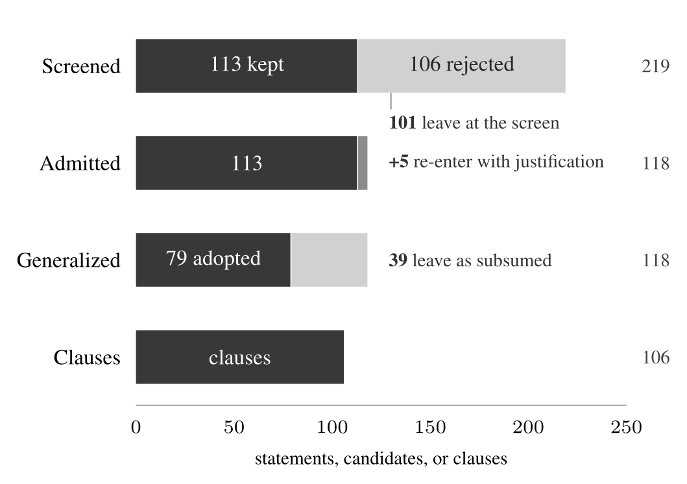

The construction funnel. [PDF](f01/f01-funnel.pdf)

### Figure 2

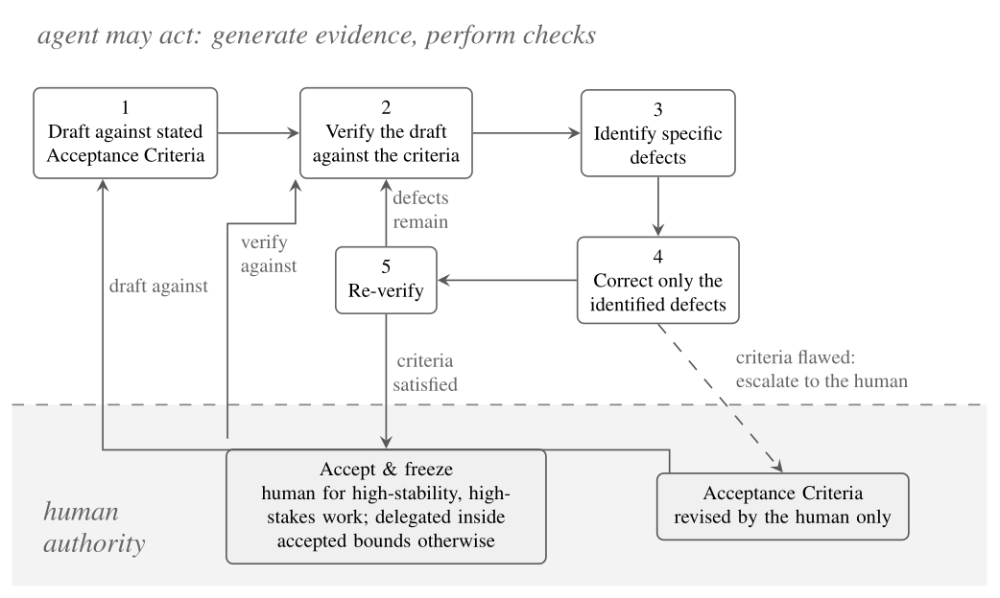

The verification loop of Verification-First Engineering, with the authority boundary drawn through it. [PDF](f02/f02-verification-loop.pdf)

### Figure 3

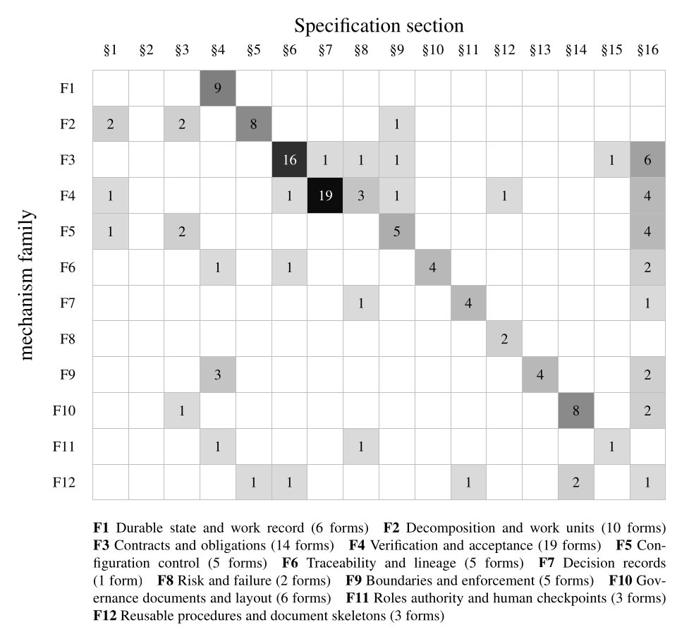

The twelve mechanism families against the sixteen sections of the Specification. [PDF](f03/f03-family-section-matrix.pdf)

### Figure 4

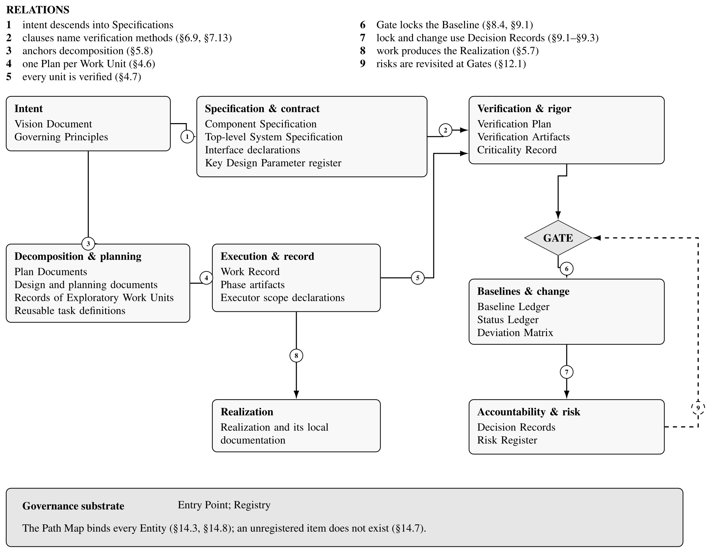

The required Entities grouped by concern, with the relations the Specification declares between them. [PDF](f04/f04-entity-model.pdf)

### Figure 5

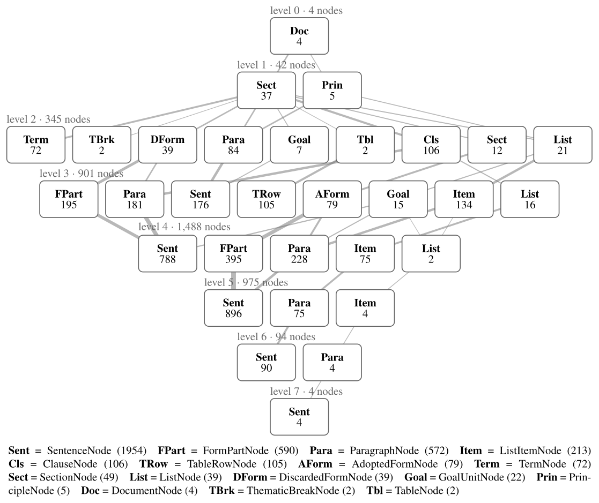

The containment tree of the corpus, aggregated to one chip per depth and node type. [PDF](f05/f05-graph-structure.pdf)

### Figure 6

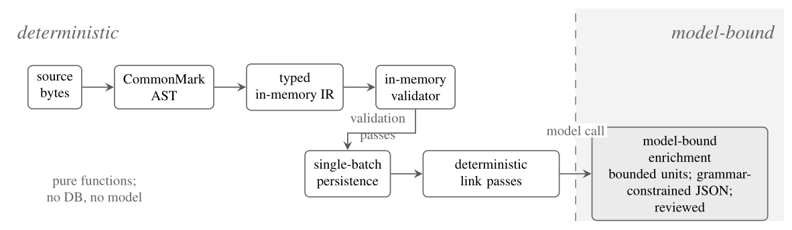

The ingestion pipeline and its determinism boundary. [PDF](f06/f06-ingestion-pipeline.pdf)

### Figure 7

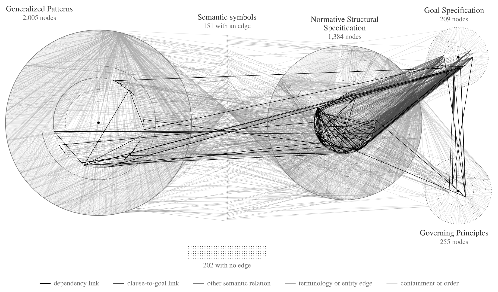

The semantic graph in full: every one of the 4,206 nodes and every edge of the dependency database, recomputed 2026-09-21. [PDF](f07/f07-semantic-graph.pdf)

### Figure 8

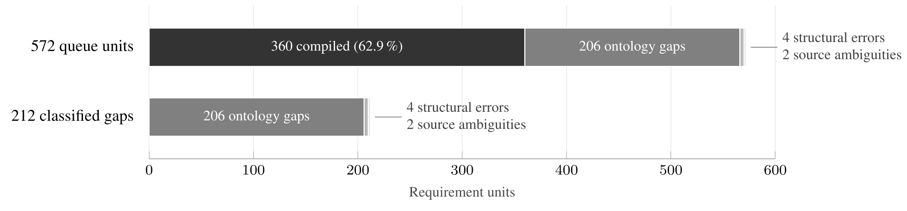

Representation coverage over the 572 requirement units. [PDF](f08/f08-coverage.pdf)

### Figure 9

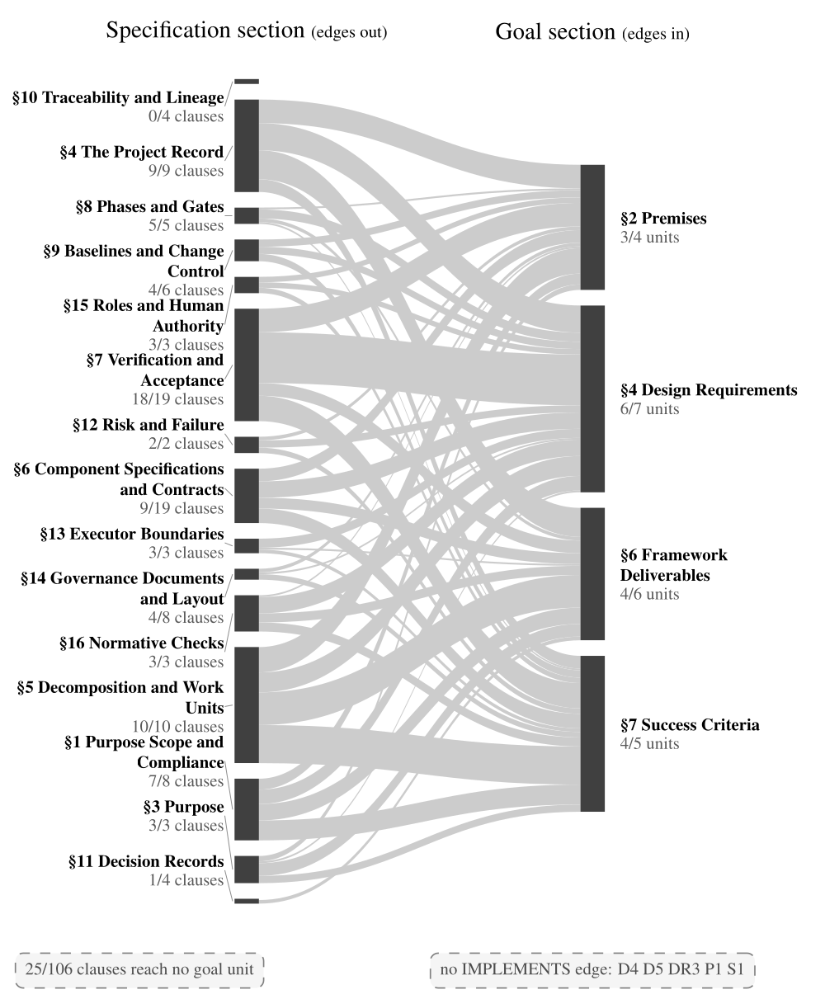

The reviewed clause-to-goal relation, aggregated from 331 clause-to-goal links into bands between clause sections on the left and goal units on the right, with band thickness proportional to edge count. [PDF](f09/f09-relation-graph.pdf)

### Figure 10

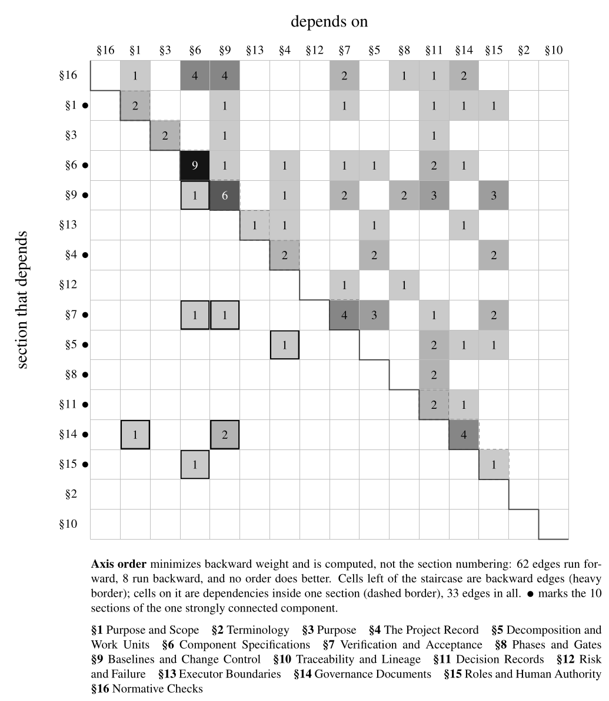

The 103 clause-to-clause dependency links aggregated into an ordered section matrix, with 62 edges forward of the diagonal, 33 within a section, and 8 backward. [PDF](f10/f10-dependency-structure.pdf)

### Figure 11

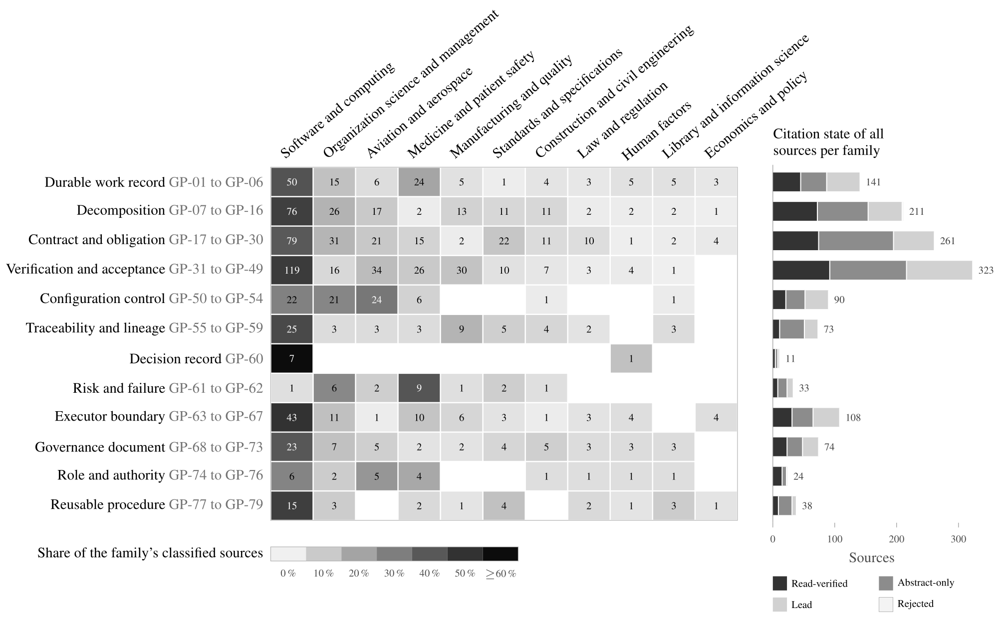

Located literature per mechanism family, by source domain and by citation state. [PDF](f11/f11-literature-domains.pdf)
## Tool per figure

| Figure | Content | Tool used in the paper |
| --- | --- | --- |
| Figure 1 | Research funnel | PGFPlots |
| Figure 2 | Verification loop | TikZ |
| Figure 3 | Family x section matrix | PGFPlots |
| Figure 4 | Entity model | TikZ |
| Figure 5 | Graph structure and magnitude | PGFPlots |
| Figure 6 | Ingestion pipeline | TikZ |
| Figure 7 | The whole semantic graph | TikZ at printed size, geometry and group coordinates from `f07/f07-semantic-graph.py` |
| Figure 8 | Coverage and abstention | PGFPlots |
| Figure 9 | The relation graph | PGFPlots (section-level alluvial) |
| Figure 10 | Dependency structure of the Specification | PGFPlots (section-level ordered matrix) |
| Figure 11 | Located literature by family, domain, and citation state | TikZ with pgfplotstable (family x domain matrix and state bars) |

## Data sources

The committed CSV and TeX data files are the inputs for the paper figures. The generator scripts require the external project data listed below. These inputs are not included in this repository.

| Figure | Generator input |
| --- | --- |
| Figure 1 | Source collection, screening, and generalization records; clause database |
| Figure 3, Figure 5 | `subspec/canonical.db` |
| Figure 7, Figure 10 | `subspec/e1-dependencies-graph.db` |
| Figure 8, Figure 9 | `subspec/e1-relation-ratified.db` |
| Figure 11 | `reports/evidence-audit/literature-map.csv` |

The paper states the measurement dates, data counts, and review policies.
